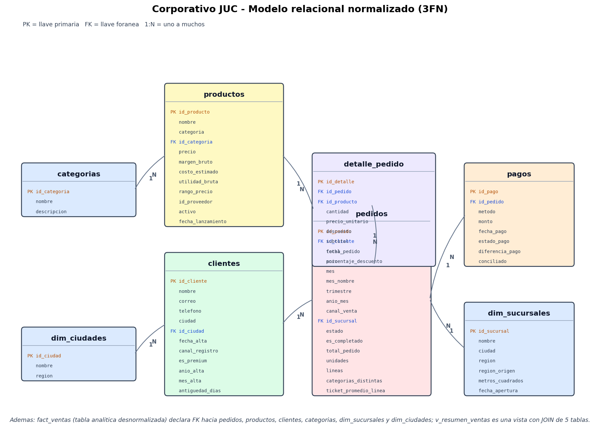

# Modelo relacional y normalizacion (3FN)

Generado: 2026-10-18 13:20:07

## Tablas y llaves primarias

| Tabla | Llave primaria |
|---|---|
| `categorias` | `id_categoria` |
| `dim_ciudades` | `id_ciudad` |
| `dim_sucursales` | `id_sucursal` |
| `clientes` | `id_cliente` |
| `productos` | `id_producto` |
| `pedidos` | `id_pedido` |
| `detalle_pedido` | `id_detalle` |
| `pagos` | `id_pago` |
| `fact_ventas` | `id_detalle` |

## Llaves foraneas

| Columna hija | Referencia |
|---|---|
| `clientes.id_ciudad` | `dim_ciudades.id_ciudad` |
| `productos.id_categoria` | `categorias.id_categoria` |
| `pedidos.id_cliente` | `clientes.id_cliente` |
| `pedidos.id_sucursal` | `dim_sucursales.id_sucursal` |
| `detalle_pedido.id_pedido` | `pedidos.id_pedido` |
| `detalle_pedido.id_producto` | `productos.id_producto` |
| `pagos.id_pedido` | `pedidos.id_pedido` |

## Llaves foraneas de la tabla analitica

`fact_ventas` es el desnormalizado intencional, pero conserva la llave de cada
dimension y las declara como FK, de modo que el modelo estrella queda completo
tambien en el motor (y visible en el *schema visualizer*):

| Columna `fact_ventas` | Referencia |
|---|---|
| `fact_ventas.id_pedido` | `pedidos.id_pedido` |
| `fact_ventas.id_producto` | `productos.id_producto` |
| `fact_ventas.id_cliente` | `clientes.id_cliente` |
| `fact_ventas.id_categoria` | `categorias.id_categoria` |
| `fact_ventas.id_sucursal` | `dim_sucursales.id_sucursal` |
| `fact_ventas.id_ciudad` | `dim_ciudades.id_ciudad` |

## Por que el modelo esta en Tercera Forma Normal

El dataset del ETL llega **desnormalizado** (una fila por linea de venta con
ciudad, categoria, cliente y producto repetidos). `etl_load.py` lo parte en
dimensiones y hechos para cumplir 1FN, 2FN y 3FN:

1. **1FN (atomicidad).** Ninguna celda guarda listas. Los atributos del
   producto (`atributos`, `etiquetas`) y la actividad web, que si son listas o
   subdocumentos, se sacan del modelo relacional y viven en MongoDB, donde el
   documento anidado es la unidad natural.

2. **2FN (sin dependencias parciales).** En `detalle_pedido` la llave es
   `id_detalle` (linea). Los datos que dependen solo de `id_producto`
   (`nombre`, `categoria`, `precio`, `margen_bruto`) se movieron a `productos`;
   los que dependen solo de `id_pedido` (`fecha_pedido`, `canal_venta`,
   `id_sucursal`) se movieron a `pedidos`. Una linea ya no repite el nombre del
   producto ni la fecha del pedido.

3. **3FN (sin dependencias transitivas).** Ninguna columna no clave depende de
   otra columna no clave:
   - `productos.categoria` era un atributo de la categoria; se extrajo a
     `categorias.nombre` y queda la FK `productos.id_categoria`.
   - `clientes.ciudad/region` dependian de la ciudad; se extrajo a
     `dim_ciudades` y queda la FK `clientes.id_ciudad` (la ciudad, no el
     cliente, define la region).
   - `pedidos.id_sucursal` apunta a `dim_sucursales`, que concentra direccion,
     region y metros cuadrados de la tienda.

## Relaciones (cardinalidad 1:N)

- `dim_ciudades` 1:N `clientes`
- `categorias` 1:N `productos`
- `clientes` 1:N `pedidos`
- `dim_sucursales` 1:N `pedidos`
- `pedidos` 1:N `detalle_pedido`
- `productos` 1:N `detalle_pedido`
- `pedidos` 1:N `pagos`

## Objetos de servicio (no normalizados, a proposito)

- `fact_ventas`: tabla ancha derivada del dataset limpio. No es una vista SQL
  porque es el **contrato de columnas** que consumen los reportes: materializar
  el JOIN una vez evita repetirlo en cada grafico. Aun asi declara FK hacia
  `pedidos`, `productos`, `clientes`, `categorias`, `dim_sucursales` y
  `dim_ciudades` para que el esquema estrella sea explicito.
- `v_resumen_ventas`: **vista** que encapsula el JOIN de 5 tablas
  (`pedidos`, `detalle_pedido`, `clientes`, `productos`, `categorias`) para el
  pulso mensual. Aqui la vista si aplica porque el resultado se consulta a
  menudo y su definicion se gobierna en la base, no en el ETL.
