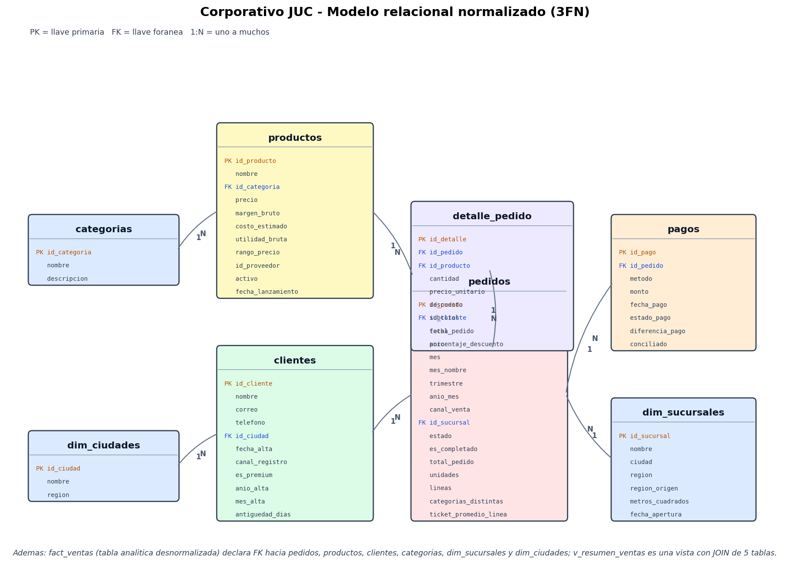

# Resumen ejecutivo

**Corporativo JUC S.A. de C.V.** es una empresa ficticia de electronica en
Mexico. Este proyecto construye un pipeline de ingenieria de datos completo:
genera tres fuentes crudas con errores intencionales, las limpia con 10
transformaciones auditables, las carga en PostgreSQL (modelo relacional 3FN) y
en MongoDB (documentos), responde 47 preguntas de negocio y produce 13
visualizaciones interactivas y 22 indicadores.

Cifras de la ultima ejecucion (semilla `SEED = 20260904`):

| Indicador | Valor |
|---|---|
| Facturacion (pedidos completados) | $127,336,206.51 |
| Pedidos completados / totales | 1,483 / 2,259 |
| Ticket promedio | $85,863.93 |
| Tasa de cancelacion | 34.35% |
| Unidades vendidas | 10,782 |
| Utilidad bruta | $37,982,053.12 |
| Margen real ponderado | 29.46% |
| Clientes con al menos un pedido | 1,314 |
| Productos vendidos | 514 de 606 |
| Preguntas respondidas | 20 SQL + 12 pipelines + 15 `find`/`count` |

El proyecto es **reproducible**: la semilla fija los datos y una sola orden
(`python src/run_all.py`) regenera todo el pipeline.

# Objetivo y alcance

**Objetivo general:** demostrar un flujo de ingenieria de datos de extremo a
extremo, desde fuentes crudas y sucias hasta analisis y visualizacion, usando
PostgreSQL, MongoDB y servicios cloud.

**Objetivos especificos:**

- Generar fuentes con errores intencionales y documentar su calidad.
- Implementar un ETL con 10 transformaciones y campos derivados.
- Modelar y cargar un esquema relacional normalizado (3FN) en PostgreSQL.
- Modelar colecciones documentales e implementar consultas y pipelines en MongoDB.
- Integrar ambos motores con Pandas para responder preguntas que ninguno resuelve solo.
- Desplegar en servicios cloud (Supabase y MongoDB Atlas) con degradacion local.
- Producir un reporte con indicadores y visualizaciones.

**Fuera de alcance:** datos reales de produccion, alta disponibilidad 24/7,
streaming en tiempo real y modelos predictivos avanzados.

# Arquitectura

Cuatro componentes obligatorios:

1. **ETL (Python + Pandas):** extrae, limpia, homologa y deriva campos; deja
   evidencia de calidad.
2. **PostgreSQL:** datos estructurados y transaccionales (clientes, pedidos,
   detalle, pagos) con integridad referencial.
3. **MongoDB:** documentos con atributos variables (catalogo semiestructurado,
   resenas y eventos de navegacion).
4. **Cloud:** PostgreSQL administrado en Supabase y MongoDB Atlas; almacenamiento
   y computo simulados con un arbol de carpetas portable.

```
Fuentes crudas                 ETL                        Almacenes
---------------          -----------------        -------------------------
CSV (A)          ->  extraer -> transformar  ->  PostgreSQL (3FN + vista)
JSON (B)         ->  (10 reglas) -> cargar   ->  MongoDB (documentos)
Sheets/XLSX (C)  ->                          ->  data/sql, data/nosql

Almacenes -> Analisis (Pandas) -> Reportes CSV + Visualizacion (Plotly/HTML)
```

El flujo se orquesta con `src/run_all.py` en cinco etapas:
`generar -> etl -> integracion -> analisis -> graficos` (y `tests` opcional con
`--con-tests`).

# Estructura del repositorio

```
Proyecto_BigData/
  src/                     codigo del pipeline
    config.py              rutas, semilla, minimos, catalogos
    utils.py               logging, tracker de calidad, tablas
    generate_sources.py    Parte I: 3 fuentes crudas con errores
    etl_extract.py         extraccion + evidencia por tabla/columna
    etl_transform.py       10 transformaciones (T01..T10)
    etl_load.py            3FN + datasets analiticos + documentos
    integration.py         DDL, carga, 20 SQL, 12 pipelines, 15 find
    analysis.py            19 analisis de negocio
    viz.py                 13 graficos Plotly -> HTML
    er_diagram.py          diagrama ER (PNG) + justificacion 3FN
    run_all.py             orquestador de etapas
  tests/                   167 pruebas (transform, integration, analysis, run_all)
  docs/                    memoria (.md/.docx/.pdf) y guion de presentacion
  .opencode/skills/        project-docs, data-pipeline, informe-juc
  data/
    raw/csv, raw/json, raw/sheets     fuentes crudas
    processed/tablas                  tablas normalizadas 3FN
    processed/dataset_postgresql.csv  dataset para PostgreSQL
    processed/dataset_mongodb.json    documentos para MongoDB
    processed/integracion/            SQLite local (solo modo local)
    sql/                              01_ddl.sql, 02_consultas.sql, EXPLAIN
    nosql/                            NDJSON, indices.json, pipelines y consultas
    reports/                          calidad, consultas_sql/, consultas_mongodb/,
                                      analisis/, modelo_relacional.md/.png,
                                      integracion_entorno.md, figuras_indice.csv,
                                      reporte.html
    figures/                          13 HTML + plotly.min.js
  logs/                    pipeline.log y artefactos de referencia
  README.md                guia principal
  README_CARPETAS.md       mapa detallado de carpetas
  GUIA_CONEXION_NUBE.md    configuracion de Supabase y Atlas
  .env.example             plantilla de credenciales (sin secretos)
```

# Parte I - Fuentes de datos

Se generan tres fuentes con formatos distintos y errores deliberados:

| Fuente | Origen | Formato | Errores inyectados |
|---|---|---|---|
| A | CSV | `.csv` | duplicados, ciudades con varias grafias, precios como texto (`$1,234.56`), fechas ambiguas, PK no numericas, nulos y tipos mezclados |
| B | JSON | `.json` | estructura semiestructurada, atributos variables por familia, anidamiento |
| C | Google Sheets | `.xlsx` | ciudades y categorias sucias, regiones inconsistentes con la ciudad |

Archivos:

- `data/raw/csv/`: `clientes.csv`, `productos.csv`, `pedidos.csv`,
  `detalle_pedido.csv`, `pagos.csv`.
- `data/raw/json/`: `productos_semiestructurados.json`, `resenas.json`,
  `actividad_usuario.json`.
- `data/raw/sheets/`: `sucursales.xlsx`, `proveedores.xlsx`,
  `promociones.xlsx`, `objetivos_venta.xlsx`.

La Fuente C se documenta como **Google Sheets exportado a `.xlsx`**: en
produccion se leeria con la Sheets API o el enlace de exportacion, con las
mismas columnas.

# Parte II - ETL

## Transformaciones (T01..T10)

| ID | Transformacion | Efecto |
|---|---|---|
| T01 | Eliminacion de duplicados | una fila por clave natural |
| T02 | Normalizacion de texto | recorta, colapsa espacios, unifica mayusculas |
| T03 | Tratamiento de nulos | imputacion por regla de negocio o marca `Sin ...` |
| T04 | Correccion de tipos | enteros, decimales y booleanos con `Int64` nullable |
| T05 | Estandarizacion de fechas | formatos multiples -> `datetime64[ns]` |
| T06 | Validacion de precios | descarta negativos y texto no convertible |
| T07 | Validacion de cantidades | enteros positivos y coherencia de subtotales |
| T08 | Unificacion de categorias y ciudades | `PC`/`COMPUTADORAS` -> `Computadoras`; `Ver.`/`VERACRUZ` -> `Veracruz` |
| T09 | Eliminacion de columnas | quita columnas redundantes o vacias |
| T10 | Campos derivados | `anio_mes`, margen, rango de precio, conciliacion, etc. |

Cada transformacion registra filas antes/despues, registros afectados y la regla
aplicada en `data/reports/calidad_transformaciones.csv` (90 filas de evidencia
en la ultima corrida).

## Validacion de minimos

`data/reports/validacion_minimos.csv` demuestra que se superan los minimos del
enunciado:

| Informacion | Destino | Minimo | Final | Cumple |
|---|---|---|---|---|
| Clientes | clientes | 1000 | 1862 | SI |
| Productos | productos | 500 | 606 | SI |
| Pedidos | pedidos | 2000 | 3277 | SI |
| Detalles de pedidos | detalle_pedido | 1000 | 3891 | SI |
| Resenas | resenas (MongoDB) | 2000 | 2475 | SI |
| Navegacion | actividad_usuario (MongoDB) | 1000 | 4236 | SI |

# Parte III - PostgreSQL

## Modelo relacional (3FN)

El esquema operativo tiene las 6 tablas exigidas: `clientes`, `productos`,
`categorias`, `pedidos`, `detalle_pedido` y `pagos`. Se anaden dos dimensiones
(`dim_ciudades`, `dim_sucursales`) y una tabla de hechos analitica
(`fact_ventas`), mas la vista `v_resumen_ventas`.

Restricciones implementadas:

- **PK** en todas las tablas.
- **FK** entre pedidos-clientes, pedidos-sucursales, detalle-pedido,
  detalle-producto, pagos-pedido, productos-categoria y clientes-ciudad.
- **UNIQUE** en nombres de categoria, ciudad y sucursal, y en el nombre de producto.
- **NOT NULL** en las columnas clave.
- **CHECK** de precios positivos, margen entre 0 y 1, cantidades positivas,
  descuentos coherentes y total = subtotal - descuento.



DDL completo: `data/sql/01_ddl.sql` (copia en
`data/reports/consultas_sql/01_ddl.sql`).

## Indices y EXPLAIN ANALYZE

Se definen **19 indices** sobre claves foraneas y columnas de filtro/orden
(fechas, estado, canal, categoria, rango de precio, conciliacion). El archivo
`data/sql/03_explain_analyze.md` compara el plan **antes y despues** de crear el
indice: el plan pasa de un recorrido completo a `SEARCH ... USING INDEX`, con
una mejora de **4.03x** (0.874 ms sin indice frente a 0.217 ms con el indice
`ix_fact_anio_mes`).

## Consultas

Se ejecutan **20 consultas** (Q01..Q20) contra PostgreSQL. Cubren `INNER JOIN`,
`LEFT JOIN`, una consulta de 4+ tablas (Q19 usa 7), agregaciones
`COUNT/SUM/AVG/MIN/MAX`, `GROUP BY`, `HAVING`, `ORDER BY`, subconsultas y el uso
de la vista. Cada resultado se guarda en
`data/reports/consultas_sql/Qxx_*.csv` y el resumen en
`00_resumen_consultas.csv`.

Ejemplos de preguntas respondidas: top de productos y clientes, evolucion
mensual, mix por categoria, ticket por canal, productos nunca vendidos,
conciliacion de pagos, Pareto y detalle 360 del pedido.

# Parte IV - MongoDB

## Colecciones

| Coleccion | Documentos | Contenido |
|---|---|---|
| `productos` | 606 | catalogo con subdocumento `atributos` variable por familia |
| `resenas` | 2475 | resenas con cliente anidado, calificacion y verificacion |
| `actividad_usuario` | 4236 | eventos de navegacion, visualizacion y compra |

Documentos en `data/nosql/*.ndjson`; definicion de indices en
`data/nosql/indices.json`.

## Indices

**12 indices** en total (4 por coleccion): clave natural, categoria+precio,
atributo variable (`sparse`), rango de precio, resenas por producto/cliente,
calificacion y fecha; navegacion por producto, usuario, embudo y categoria.

## Consultas y pipelines

- **15 consultas** `find`/`countDocuments` (B01..B15) que usan `sort`, `limit`,
  `countDocuments` y los operadores `$gt`, `$lt`, `$gte`, `$lte`, `$in`, `$and`,
  `$or`.
- **12 pipelines de agregacion** (A01..A12) con `$match`, `$group`, `$sort`,
  `$project`, `$limit`, `$unwind` y `$lookup`. Responden, entre otras:
  - A02: productos muy vistos y nunca vendidos (inversion que no convierte).
  - A08: consulta dinamica sobre `atributos.procesador`, presente solo en una familia.
  - A11: calificacion promedio por categoria.
  - A12: actividad de navegacion por ciudad.

Codigo en `data/nosql/01_pipelines.js` y `data/nosql/02_consultas.js`;
resultados en `data/reports/consultas_mongodb/A*.csv` y `B*.csv`.

# Parte V - Integracion SQL + NoSQL

La pregunta central es: **¿los productos mas vistos son los mas vendidos?** No se
puede responder con un solo motor, porque las ventas viven en PostgreSQL y la
navegacion en MongoDB. Se resuelve en Python/Pandas:

1. De PostgreSQL se extrae `id_producto, cantidad_vendida, ingresos`.
2. De MongoDB se extrae `id_producto, numero_visualizaciones`.
3. Se cruzan con `merge` por `id_producto`.

Resultado (A10): **Pearson +0.323** entre visitas y unidades vendidas para los
productos visitados y vendidos. Al ampliar la poblacion, la correlacion baja:
**Pearson +0.146** sobre todos los productos y **+0.104** solo entre los
visitados; el **Spearman +0.270** sobre todos los productos confirma que la
relacion es debil y no monotona perfecta. La conclusion es que la navegacion
ayuda pero no garantiza la venta: hay 63 productos con trafico y cero unidades
vendidas, de los 92 del catalogo (606) que nunca se vendieron.

Artefactos: `11_correlacion_visitas_ventas.csv`,
`12_dispersion_visitas_ventas.csv`, `13_inventario_muerto.csv`,
`14_under_exposure.csv` y `20_cuadrantes_visitas_ventas.csv`.

# Parte VI - Cloud

| Componente | Implementacion | Estado |
|---|---|---|
| Cloud Database (SQL) | PostgreSQL 17 en Supabase (Session pooler IPv4) | real |
| Cloud Database (NoSQL) | MongoDB Atlas 8.0 (cluster M0) | real |
| Cloud Storage | arbol local `data/` con el layout del enunciado | simulado |
| Cloud Computing | ejecucion portable de Python (VM/CI/contenedor) | simulado/portatil |

Configuracion en `.env` (ignorado por git; plantilla en `.env.example`):

- `SUPABASE_HOST`, `SUPABASE_PORT`, `SUPABASE_DATABASE`, `SUPABASE_USER`,
  `SUPABASE_PASSWORD`, `PG_SSLMODE=require`.
- `MONGO_URI`, `MONGO_DB=juc`.
- Variables de control: `FORZAR_SQLITE`, `SIN_POSTGRES`, `SIN_MONGO`.

Sin credenciales, el pipeline **degrada** a SQLite y NDJSON sin fallar, de modo
que tambien se reproduce sin infraestructura.

Layout de almacenamiento (punto 26):

```
data/raw/{csv,json,sheets}           crudo (fuentes A/B/C)
data/processed/tablas                tablas normalizadas 3FN
data/processed/dataset_*.{csv,json}  datasets para los motores
data/sql/                            DDL, consultas y EXPLAIN
data/nosql/                          colecciones, pipelines, consultas, indices
data/reports/                        resultados, evidencia y reportes
data/figures/                        visualizaciones
```

# Parte VII - Visualizacion

Se generan **13 visualizaciones interactivas** con Plotly (HTML): hover con el
valor exacto, zoom y series aislables. Todas se reunen en
`data/reports/reporte.html`; cada una tambien existe por separado en
`data/figures/`.

| # | Visualizacion | Que muestra |
|---|---|---|
| 01 | Serie temporal de ventas | facturacion mensual y ticket promedio |
| 02 | Mix por categoria | participacion y margen por familia |
| 03 | Ticket y margen por canal | facturacion y margen real por canal |
| 04 | Ley de Pareto | concentracion de la venta |
| 05 | Segmentacion RFM | clientes por segmento y su peso |
| 06 | Embudo navegacion-compra | eventos por paso y caidas |
| 07 | Correlacion navegacion-venta | dispersion y ajuste lineal |
| 08 | Visitas sin venta | inventario muerto por trafico |
| 09 | Under-exposure | mucho volumen con pocas visitas |
| 10 | Descuentos vs margen | margen por rango de descuento |
| 11 | Calificaciones | distribucion de resenas y tasa positiva |
| 12 | Facturacion por sucursal | venta y ticket por sucursal |
| 13 | Ventas por ciudad | facturacion por ciudad |

Indicadores principales (22): los 10 de la Parte VII (ingresos totales, pedidos
totales, ticket promedio, clientes activos, producto mas vendido, producto mas
visto, categoria mas rentable, ciudad con mayores ventas, calificacion
promedio y mes con mayores ventas) mas pedidos completados, tasa de
cancelacion, unidades vendidas, unidades por pedido, productos vendidos,
categorias, utilidad bruta, margen real ponderado, descuentos otorgados,
ticket con y sin descuento e ingreso por cliente.

# Operacion y pruebas

```powershell
python -m venv .venv
.\.venv\Scripts\python.exe -m pip install -r requirements.txt
.\.venv\Scripts\python.exe src\run_all.py
.\.venv\Scripts\python.exe src\run_all.py --con-tests
```

Etapas y flags: `--listar`, `--sin-generar`, `--solo <etapas>`,
`--con-tests`. El pipeline se detiene en la primera etapa que falla.

Estado verificado de la ultima corrida:

| Comprobacion | Resultado |
|---|---|
| Pruebas (`pytest`) | 161 passed |
| Consultas SQL | 20/20 OK |
| Pipelines NoSQL | 12/12 OK |
| Consultas `find`/`count` | 15/15 OK |
| Visualizaciones | 12/12 OK |
| Diagrama ER | generado |
| Nulos en el dataset final | 0 |

# Limitaciones y trabajo futuro

- Datos **sinteticos**: las conclusiones describen la empresa ficticia, no un
  negocio real.
- Pandas trabaja en memoria; para volumenes mayores habria que migrar el ETL a
  Spark/Dask.
- Cloud Storage y Cloud Computing estan **simulados** con el arbol local y la
  portabilidad del codigo; no se aprovisionan buckets ni VMs.
- El reporte visual es HTML: no se incrusta en Word; se entrega como
  `reporte.html` y se imprime a PDF desde el navegador si hace falta.
- Mejoras: orquestacion programada (cron/Airflow), monitoreo de calidad,
  pruebas de carga y un modelo predictivo de churn/recomendacion.

# Anexos

## A. Diccionario de datos (resumen)

- `clientes`: `id_cliente`, `nombre`, `ciudad`, `region`, `es_premium`, `antiguedad_dias`.
- `productos`: `id_producto`, `nombre`, `id_categoria`, `categoria`, `precio`,
  `costo`, `margen_bruto`, `rango_precio`.
- `pedidos`: `id_pedido`, `id_cliente`, `id_sucursal`, `fecha_pedido`,
  `anio_mes`, `estado`, `canal_venta`, `total_pedido`.
- `detalle_pedido`: `id_detalle`, `id_pedido`, `id_producto`, `cantidad`,
  `precio_unitario`, `descuento`, `subtotal`, `total`.
- `pagos`: `id_pago`, `id_pedido`, `metodo`, `monto`, `estado_pago`,
  `diferencia_pago`, `conciliado`.
- `categorias`: `id_categoria`, `nombre`.

## B. Consultas y evidencia

- `data/reports/consultas_sql/`: `01_ddl.sql`, `02_consultas.sql`,
  `03_explain_analyze.md`, `04_explain_analyze.csv`, `Q01..Q20`.
- `data/reports/consultas_mongodb/`: `01_pipelines.js`, `02_consultas.js`,
  `A01..A12`, `B01..B15`.
- `data/reports/calidad_transformaciones.csv` y `validacion_minimos.csv`.

## C. Indice de figuras

`data/reports/figuras_indice.csv` lista las 13 visualizaciones con su archivo,
estado y tamano. El reporte unificado es `data/reports/reporte.html`.
